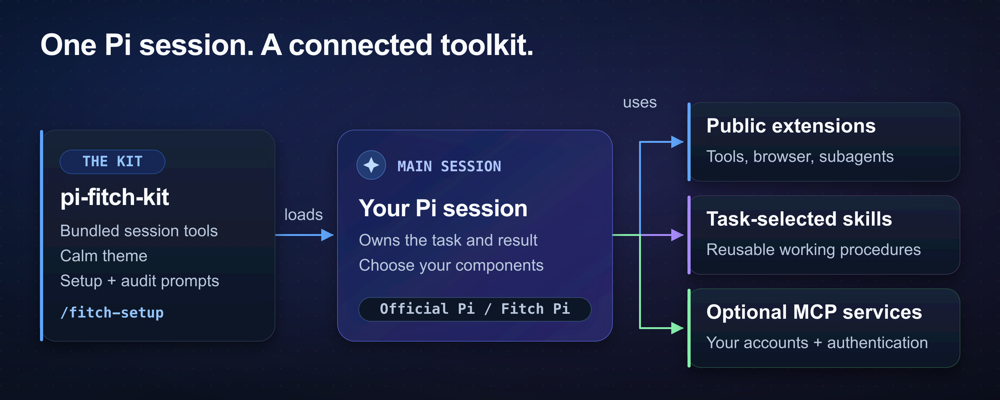

# pi-fitch-kit

Fitch Kit adds session tools and a setup prompt to [Pi](https://github.com/earendil-works/pi), a terminal coding agent. Use the setup prompt to select public extensions, specialist agents, skills, and service connections.



## Install

Use **Node.js 24.15+** and **Pi 1.0.0+**. The kit supports official Pi and [Fitch Pi](https://github.com/fitchmultz/pi).

1. Install Pi if you do not have it.

   ```bash
   npm install -g --ignore-scripts @earendil-works/pi-coding-agent
   ```

2. Start Pi. Complete your provider login.

   ```bash
   pi
   ```

3. Install the kit.

   ```bash
   pi install git:github.com/fitchmultz/pi-fitch-kit
   ```

4. Start a new Pi process. Run this command in the Pi editor.

   ```text
   /fitch-setup
   ```

Setup previews package installs and file changes. Select the complete core or individual components.

The kit works without `pi-subagents`. Delegation, profile inventory, and child-run settings belong to a selected or already installed delegation package. The optional process working agreement requires independent review, not a particular packaged profile name. An unavailable required reviewer or model family leaves that gate unsatisfied; self-review is not a substitute.

Start a new Pi process if setup changes extension code or dependencies. Run `/fitch-setup verify` to check setup without changes.

Setup keeps the kit's opinionated model baseline: `gpt-6-astra` through OpenAI/Codex and Claude through a supported route for its OpenAI/Codex and Claude workflows, including the Claude-specific image/fast-mode boundary. This is kit policy, not a sibling-profile prerequisite or proof that independent review is available. See the [model groups](setup-manifest.json) for the unchanged allowed routes.

## Commands

The package loads seven extensions, two prompts, and the `calm` theme. Setup installs the external components you select.

| Command | Use |
|---|---|
| `/draft <text>` | Rewrite a request in a separate dialog. Review the result before you accept it. |
| `/ambitious <text>` | A concise, context-aware, more ambitious request: outcome, expert methods, justified targets, and runnable verification. Maximum 1,800 characters; same dialog as `/draft`. |
| `/side-question <text>` | Ask a question with session context. The answer stays outside the main conversation. |
| `/reader demo` | Open a sample document without a model call. Press Right/Space for the next page. Press Left for the previous page. Press Escape to close. |
| `/reader` or `/reader list` | Show the saved page or document list. Press `N` to write a section note. Use Ctrl+Enter to request a response. |
| `/clean-footer` | Switch between the compact and built-in footers. |
| `/codex-fast status`, `/anthropic-fast status`, `/xai-fast status` | Check the shared fast-mode settings. |
| `/github-open-issues-prs` | Start the prompt for an audit of open GitHub issues and pull requests. |

Session names help you find saved sessions. The Claude image guard adapts Claude images to provider limits. The setup model tool reads the current model registry without a provider call.

`/draft`, `/ambitious`, and `/side-question` make model calls with your current provider, model, and thinking level. See [writer settings](docs/reference.md#draft-provider-model-and-thinking) and [reader controls](docs/reference.md#extensions-bundled-by-this-kit) for details.

## Settings

Setup offers the [settings example](examples/settings.json) and model context windows as separate choices. Setup preserves existing values unless you select a change.

| Setting | Choice |
|---|---|
| `images.autoResize` | Set `false` to preserve source image detail. The Claude image guard still applies. |
| `compactView` | Optional. Requires a Pi runtime that supports compact view. |
| `compaction` | The example reserves 64,000 tokens and retains 40,000 recent tokens. |
| `modelContextWindows` | The manifest offers 300,000 tokens per route. Check route pricing before you increase a window. |

Use `/reload` after changes to settings or other non-code resources. See the [configuration reference](docs/reference.md) for exact limits and options.

## Limits and safety

Fast modes can increase provider charges. Read the [fast-mode reference](docs/reference.md#fast-modes) before you enable a fast mode.

Anthropic Opus fast mode is a research preview with doubled token rates. Ultrafast uses 6× API/credit pricing or 8× Codex included usage. Only exact `gpt-6-astra` on supported native OpenAI/Codex routes can use Ultrafast. Installation does not enable Ultrafast.

Footer status shows the requested policy. Check provider billing for actual charges.

Extensions use your operating-system permissions. Project trust and working agreements do not create a sandbox. Select trust settings for your environment.

Service connections need your accounts and authentication. Credentials, private endpoints, browser profiles, and sessions stay outside the public kit. Setup does not patch or replace Pi.

[macuse](https://github.com/fitchmultz/macuse) is an experimental macOS add-on outside the core setup. Its private ChatGPT runtime interfaces can change. Review its limits before installation.

## Reference

- [Configuration and workflow](docs/reference.md): commands, package sources, migration notes, and extension, agent, and skill catalogs.
- [Full setup guide](docs/pi-setup.md): a task from service context through code changes and delivery.
- [Setup overview](docs/pi-setup-post.md): how the components fit together.
- [Development and validation](docs/development.md): local checks and CI details.
- [Changelog](CHANGELOG.md): version history.

## License

[MIT](LICENSE).
