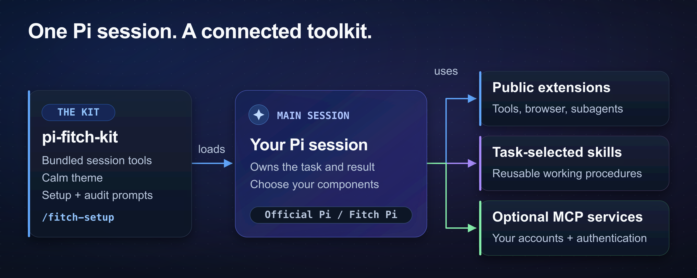

# pi-fitch-kit

Fitch Kit is a package for [Pi](https://github.com/earendil-works/pi), a terminal coding agent. It has two parts:

- **Session tools** that load with the package: a compact footer, session naming, fast-mode controls, prompt-writing commands, a Claude image guard, and a paged reader.
- **A setup prompt**, `/fitch-setup`, that installs the public packages I use with Pi and offers my settings.



## Install

I run [Fitch Pi](https://github.com/fitchmultz/pi), my fork of Pi. The kit and every package in the setup also run on official Pi. Use the latest stable official Pi or the current Fitch Pi build, on a current Node.js 24 release. The kit needs **Pi 1.5.0+** and **Node.js 24.15+**. Some packages that setup installs need newer versions; setup checks them before it installs anything.

1. Install Pi if you do not have it.

   ```bash
   npm install -g --ignore-scripts @earendil-works/pi-coding-agent
   ```

2. Start Pi. Complete your provider login.

   ```bash
   pi
   ```

3. Install the kit.

   ```bash
   pi install git:github.com/fitchmultz/pi-fitch-kit
   ```

4. Start a new Pi process. Run this command in the Pi editor.

   ```text
   /fitch-setup
   ```

Setup shows one preview of every package install and file change before it acts. Take the complete core or select packages. Start a new Pi process after setup installs packages. Run `/fitch-setup verify` to check a setup without changes.

The session tools need no setup and work with any model. Step 3 is enough if you want only those.

## Commands

The package loads seven extensions, two prompts, and the `calm` theme.

| Command                                                            | Use                                                                                                                                                                                                            |
| ------------------------------------------------------------------ | -------------------------------------------------------------------------------------------------------------------------------------------------------------------------------------------------------------- |
| `/draft <text>`                                                    | Rewrite a request in a separate dialog. Review the result before you accept it.                                                                                                                                |
| `/ambitious <text>`                                                | Rewrite a request to aim higher: the outcome, expert methods, justified targets, and runnable verification. Maximum 1,800 characters.                                                                          |
| `/unreasonable <text>`                                             | Rewrite a tentative request as a forceful mandate with stronger methods and proof. It adds no scope or permissions.                                                                                            |
| `/side-question <text>`                                            | Ask a question with session context. The answer stays outside the main conversation.                                                                                                                           |
| `/reader demo`                                                     | Open a sample document without a model call. Press Right or Space for the next page, Left for the previous page, and Escape to close.                                                                          |
| `/reader` or `/reader list`                                        | Show the saved page or the document list. Press `N` to write a section note. Press Ctrl+Enter to request a response.                                                                                           |
| `/clean-footer`                                                    | Switch between the compact footer and Pi's built-in footer.                                                                                                                                                    |
| `/codex-fast status`, `/anthropic-fast status`, `/xai-fast status` | Check the fast-mode setting for each provider.                                                                                                                                                                 |
| `/ultrafast status`                                                | Check OpenAI Ultrafast. Read the [cost and access limits](docs/reference.md#fast-modes) before you turn it on.                                                                                                 |
| `/github-open-issues-prs [owner]`                                  | Audit open issues and PRs in public non-fork repos owned by the account. For an explicitly named user, also find all their authored issues and PRs across accessible repos, including private repos and forks. |

The kit also names sessions so you can find them later, and resizes images sent to Claude to fit Anthropic's limits. `/draft`, `/ambitious`, `/unreasonable`, and `/side-question` make model calls with your current provider, model, and thinking level.

See the [reference](docs/reference.md#bundled-extensions) for each extension's behavior and settings.

## What setup installs

Complete core is the set of public packages I run on every device. Each one is an independent repository; none depends on the kit.

| Package                                                                            | Provides                                                                                 |
| ---------------------------------------------------------------------------------- | ---------------------------------------------------------------------------------------- |
| [`pi-subagents`](https://github.com/fitchmultz/pi-subagents)                       | Delegation to child sessions, saved child runs, and messaging between local sessions     |
| [`pi-apply-edits`](https://github.com/fitchmultz/pi-apply-edits)                   | File edits: `apply_patch`, `replace_text`, and `write_files`                             |
| [`pi-posthorse`](https://github.com/fitchmultz/pi-posthorse)                       | Context rollover without a model-written summary, task notes, and history search         |
| [`pi-agent-browser-native`](https://github.com/fitchmultz/pi-agent-browser-native) | Browser automation and web search. Needs the separate `agent-browser` command-line tool. |
| [`pi-mcp-adapter`](https://github.com/fitchmultz/pi-mcp-adapter)                   | MCP servers as searchable Pi tools that load only when a task needs them                 |
| [`pi-ask-question`](https://github.com/fitchmultz/pi-ask-question)                 | Structured questions in the Pi UI                                                        |
| [`pi-change-working-dir`](https://github.com/fitchmultz/pi-change-working-dir)     | Working-directory changes in the middle of a session                                     |
| [`pi-calculator`](https://github.com/fitchmultz/pi-calculator)                     | Deterministic high-precision arithmetic                                                  |
| [`pi-ctx-info`](https://github.com/fitchmultz/pi-ctx-info)                         | `/ctx`, a breakdown of what uses the context window                                      |
| [`pi-stash`](https://github.com/fitchmultz/pi-stash)                               | Stash and restore a draft message                                                        |
| [`pi-copy-message`](https://github.com/fitchmultz/pi-copy-message)                 | Search and copy raw session messages                                                     |
| [`pi-agent-skills`](https://github.com/fitchmultz/pi-agent-skills)                 | Skills for review, QA, diagrams, handoffs, and Pi development                            |
| [`pi-pstack`](https://github.com/fitchmultz/pi-pstack)                             | Engineering workflow skills adapted from Cursor's `pstack`                               |

[`macuse`](https://github.com/fitchmultz/macuse) is an optional, experimental macOS package. It controls native apps through the Computer Use runtime installed with ChatGPT. OpenAI can change that runtime's private interfaces without notice. Read its limits before you install it.

The [setup manifest](setup-manifest.json) is the source of truth for this list. It uses the Git sources I run. Several packages also publish to npm and document that channel in their own READMEs. Pi treats npm and Git as different packages, so install only one channel for each package.

## Settings

Setup offers each key of the [settings example](examples/settings.json) and each context window as a separate choice. It keeps your existing values unless you select a change.

| Setting               | Choice                                                                                                                                 |
| --------------------- | -------------------------------------------------------------------------------------------------------------------------------------- |
| Model routes          | Astra through a ChatGPT subscription is the default, at `xhigh` thinking. Setup offers only the routes your session can use.           |
| `images.autoResize`   | `false` sends source images at full detail. The Claude image guard still applies.                                                      |
| `compaction`          | Reserve 64,000 tokens and keep 30,000 recent tokens. With Posthorse, these values set where context rolls over.                        |
| `modelContextWindows` | The manifest offers 400,000 tokens per route. For some routes that is above the native window; check the route's long-context pricing. |
| `defaultTools`        | Turns on Pi's built-in `codemode`, `tool_search`, `grep`, `find`, and `ls`.                                                            |
| `compactView`         | Optional. Needs a Pi runtime that documents compact view; Fitch Pi does.                                                               |

Use `/reload` after a settings change. See the [reference](docs/reference.md#settings-example) for details.

## Limits and safety

Fast modes can increase provider charges. Read the [fast-mode reference](docs/reference.md#fast-modes) before you turn one on. Installing the kit turns none of them on.

Extensions run with your operating-system permissions. Project trust and working agreements do not create a sandbox. Choose trust settings for your environment.

Your provider and service logins stay yours. The kit contains no credentials, private endpoints, browser profiles, or sessions, and setup does not read them. Setup does not patch or replace Pi.

## Documentation

- [How I use Pi](docs/pi-setup.md): the setup, one task from start to finish, and the reasons behind the structure.
- [Reference](docs/reference.md): bundled extensions, fast modes, the setup manifest, and settings.
- [Development](docs/development.md): local checks and CI.
- [Changelog](CHANGELOG.md): version history.

## License

[MIT](LICENSE).
